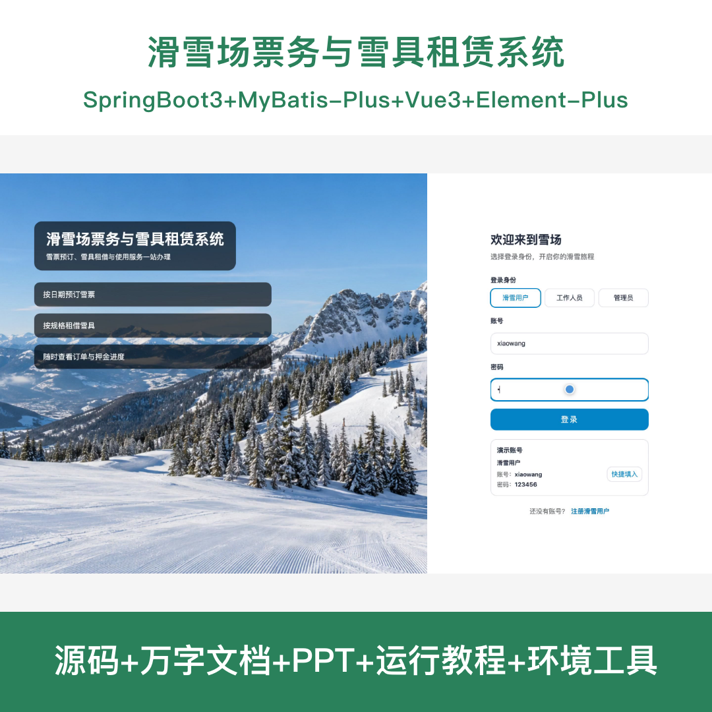
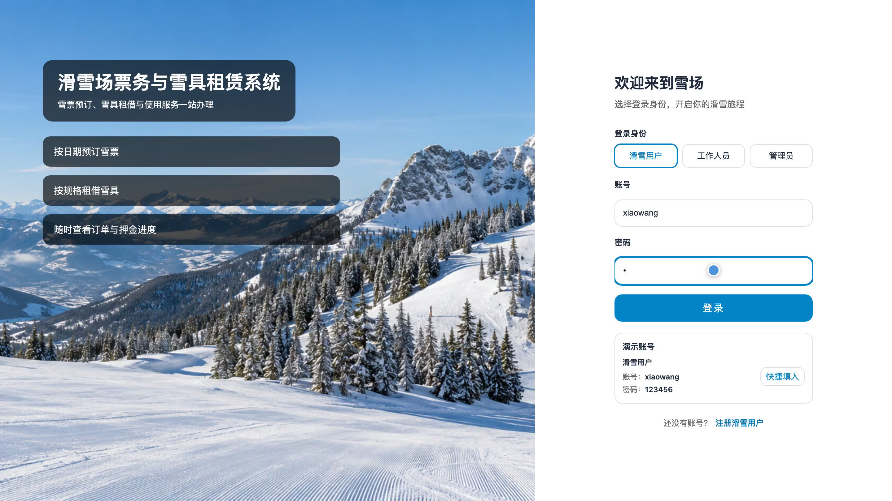
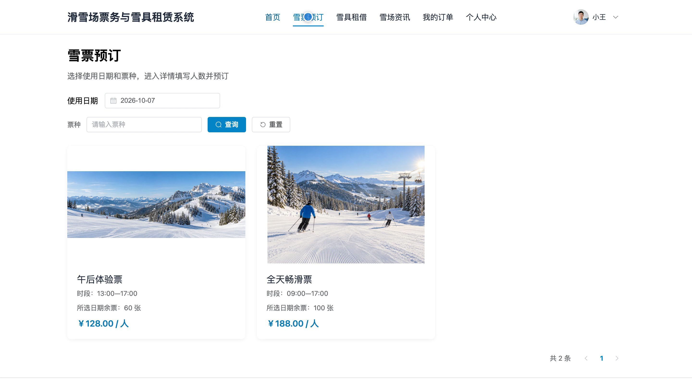
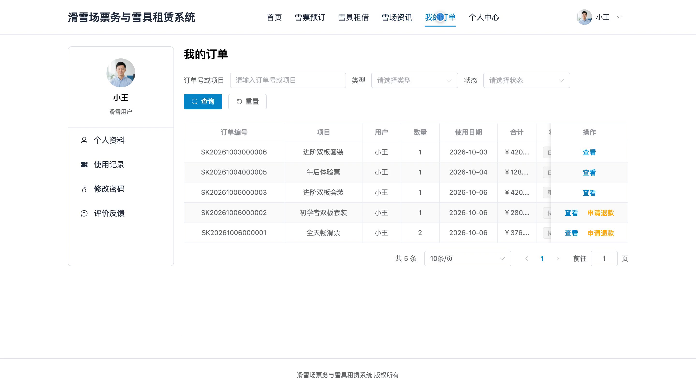
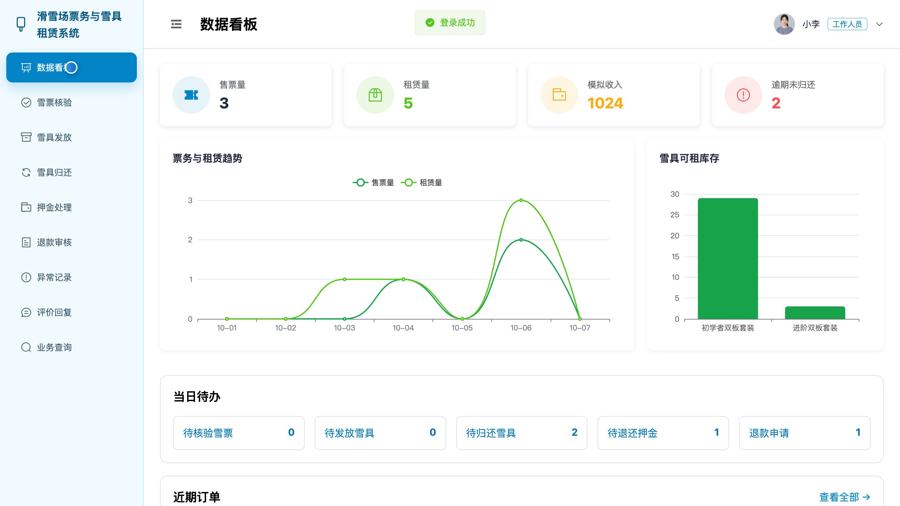
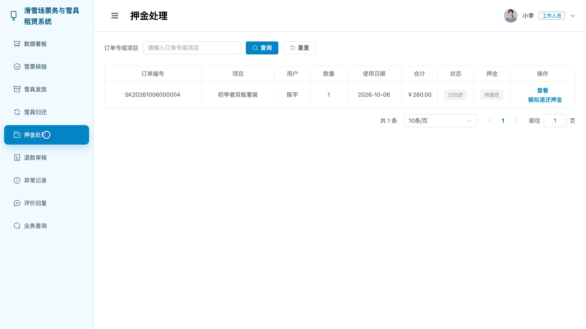
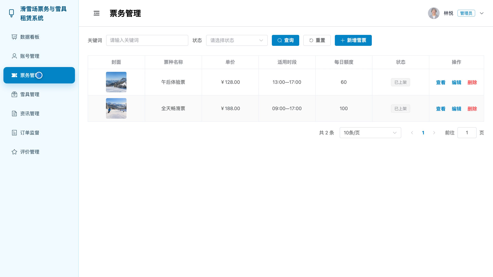
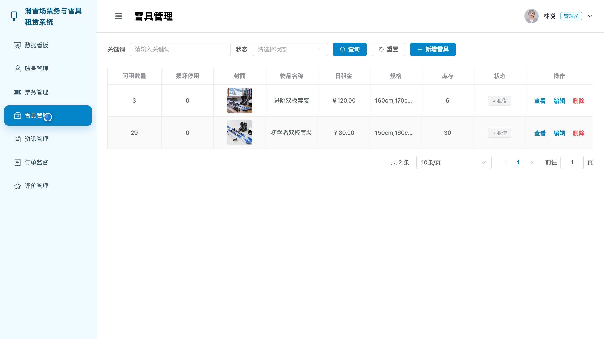

## 源码问题查看主页咨询

### 一、关键词
滑雪场售票、雪票预订、雪具租赁、滑雪装备租借、票务订单

### 二、作品包含
源码+数据库+全套环境和工具资源+本地部署教程

### 三、项目技术
前端技术： Html、Css、Js、Vue3.4、Element-Plus
后端技术：Java、SpringBoot3.2.0、MyBatis-Plus

### 四、运行环境要求
开发工具：IDEA/eclipse + VSCODE

数据库：MySQL5.7（共9张表）

数据库管理工具：Navicat10以上版本

环境配置软件： JDK17 + Maven3.6

前端Nodejs：>=20

浏览器：谷歌浏览器

### 五、项目介绍
项目编号：bs153A

滑雪场票务与雪具租赁系统面向滑雪用户、工作人员和管理员，提供雪票预订、雪具租借、订单处理、入场核验及库存与资讯管理。

角色：滑雪用户、工作人员、管理员

滑雪用户功能：雪场资讯与入场说明查阅、雪票日期票种人数选择及预订、雪具规格数量租期选择及租借、订单查询与模拟支付及退款申请、雪票核验及雪具归还状态查询、订单评价与回复查看、个人资料头像和密码维护。

工作人员功能：雪票订单核验、雪具发放与归还登记、租赁押金退还处理、订单退款审核、雪具损坏缺失和逾期异常记录、用户评价回复、票务与租赁业务查询、业务数据看板与个人资料维护。

管理员功能：滑雪用户与工作人员账号管理、雪票价格额度和上架管理、雪具规格租金和库存管理、雪场资讯与公告管理、购票和租赁订单监督、用户评价管理、售票租赁和库存数据统计、个人资料与密码维护。

### 六、运行截图

